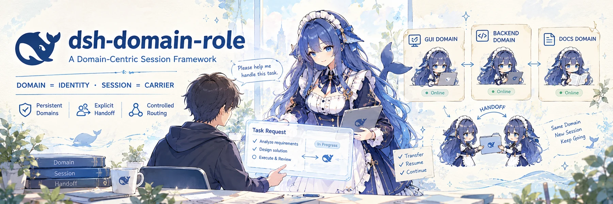
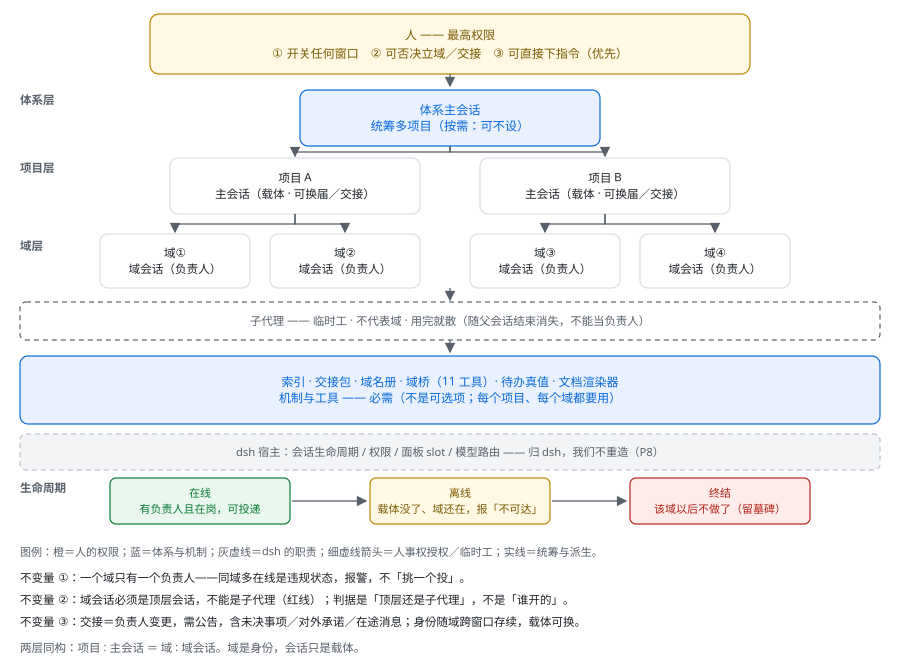
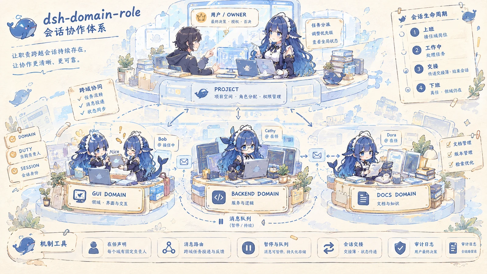
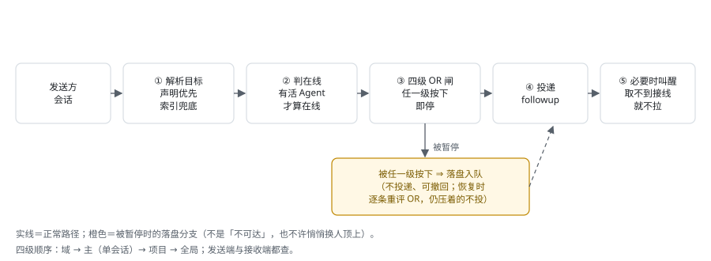

# 域身份会话框架 · `dsh-domain-role`



> **把「会话」当成人来管**：有身份、有岗位、有在任与离任。消息是请求，不是命令。
> **身份放在「域」上，会话只是载体**——窗口会关、会换届，域不会。

> **English summary**: A cross-session governance framework for DeepSeek Harness (dsh). Instead of treating chat windows as disposable workers, it gives every area of responsibility a durable *domain* identity, an explicit *duty declaration* ("who owns this domain right now"), a mailbox with pause/queue semantics, and role task books that let a new session start working in one message. It is deliberately **not** another agent-team runtime: the unit of identity is the domain, not the session.

> ⚠️ **状态：实验性 / 半成品（插件 v0.8.16）**。这份代码是作者本人在用的工作系统，接口与目录结构仍会变。别把它当稳定版依赖。

---

## 它想解决什么

AI 编程的日常里，有三件事反复伤人：

1. **长会话越用越贵、越用越脏**——上下文越长，单步成本越高、越容易被污染；可换个新窗口，又等于把"为什么这么做"全丢了。
2. **多项目 / 多域并行时，没人知道谁负责哪块**——靠"猜"和"我记得上次是谁"必然出错；并行两条会话改同一批文档则是事故。
3. **现成的 agent team 以会话为本**——Leader 一换届，整张协作网归零；而真正需要跨窗口存续的是"这块业务归谁"，不是"哪个窗口"。

这个框架的答案是把**身份**和**载体**拆开：域是身份，会话是载体。

## 三个核心概念

| 概念 | 是什么 | 不是什么 |
|---|---|---|
| **域（domain）** | 一块长期职责（如 `gui`／`backend`／`docs`），**跨窗口存续** | 不是工作区，也不是目录 |
| **会话（session）** | 承载域的窗口／Agent，**可换届、可交接、可离线** | 不是身份本身 |
| **在任声明（duty declaration）** | 一行显式记录：「这个域现在归谁」 | 不是任务清单，也不存历史 |

配套两条不变量：

- **一个域只有一个负责人**。同域多在线是**违规状态**，不是容错——发现就报警，不"挑一个投"。
- **域的负责人必须是顶层会话**。子代理随父会话结束就消失，顶不了这个位置。

## 架构



五层，从上到下：**人**（最高权限：开关任何窗口／否决立域与交接／可直接下指令）→ **体系层**（体系主会话，统筹多项目，按需）→ **项目层**（项目 ＋ 项目主会话）→ **域层**（域 ＋ 域会话＝负责人）→ **子代理**（临时工，不代表域）。
底部是一条**必需的机制与工具**带（索引／交接包／域名册／域桥／待办真值／文档渲染器），再下面是宿主（会话生命周期、权限、面板、模型路由——归 dsh，本框架不重造）。

两条身份链：

- **两层同构**：`项目 : 主会话 ＝ 域 : 域会话`
- **生命周期**：在线（有负责人且在岗）→ 离线（载体没了、域还在）→ 终结（该域以后不做了，留墓碑）

同一套关系画成插画版：用户与项目之下挂着三个域（`GUI` / `BACKEND` / `DOCS`，每个域一名负责人在任），域之间靠**消息队列**往来，右侧是**会话生命周期**（上班 → 工作中 → 交接 → 下班；同一域换个会话接着干），底部那条就是上面说的**机制与工具**带。



## 一次跨域消息怎么走



解析目标（声明优先、索引兜底）→ 判在线 → **四级 OR 暂停闸**（域／主／项目／全局，任一级按下即停）→ 投递或被暂停时**落盘入队**（可撤回，不许静默换人）→ 必要时叫醒（取不到"接线"就不拉活）。
恢复暂停不是"一股脑全投"，而是**逐条重评 OR**：只重投"现在不再被任何一级压着"的消息。

## 主要组件

| 组件 | 作用 | 位置 |
|---|---|---|
| **角色任务书** | 每个会话角色一份机读任务书（`ROLE`／`SLOTS` 头 ＋ 角色／开场／规则三段），渲染成纯文本首条消息 | `templates/roles/` |
| **派发口径** | 三级会话怎么分工、任务怎么派、编号怎么编、达成报告五段字段 | `templates/dispatch-template.md` |
| **索引** | 从会话存档、使命库与域名册生成「谁在动哪个文件、有没有冲突」 | `tools/session-registry.mjs` |
| **交接包** | 给接手方生成开局材料（默认 JSON，要人读时现渲一页 MD） | `tools/session-registry.mjs --handoff` |
| **域桥插件** | dsh 宿主插件，12 个工具：投递／建会话／认领／释放／暂停／撤回／列在任／列会话／列模型／改模型／改默认模型；外加**六条斜杠命令**（`/register` `/initialize` `/handoff` `/retire` `/pause` `/pause-all`，v0.8 起带**弹窗菜单**，不用背参数） | `plugins/dsh-domain-bridge/` |
| **文档渲染器** | 结构化数据 → 单文件 HTML（数据是唯一可编辑处，页面是产物） | `tools/render-doc.mjs` |

## ⚠️ 安全与风险（用之前先读）

这套东西的风险**不是"仓库里有漏洞"，而是"你把会话的管理权交给了模型"**。下面是已知且**刻意没修**的几处——不是待办清单，是设计取舍，请按这个前提使用：

| 风险 | 具体是什么 | 建议 |
|---|---|---|
| **特权动作没有独立授权校验** | `force:true`（越过暂停 / 强制交接域负责人）、`set_default_model`（改全局默认模型）、`permissionPreset`（改新会话权限档）**只靠模型遵守工具描述**。会话被内容注入诱导时，它可能做出你没授权的跨会话操作 | 只在可信工作区开这些工具；高风险动作人看着做；**别把不可信网页/文件内容直接喂给开着这些工具的会话** |
| **项目级暂停是政策门，不是中断器** | 它拦新的投递与会话创建，但**不会中断已经开始跑的回合** | 要立刻停手，得人去打断那条会话，别指望暂停 |
| **未读的 `inject` 队列不持久** | dsh 重启时可能被整体取消，你会以为"发过了"，其实没发出去 | 要保证对方真的处理，用 `followup` / `steer`，别用 `inject` 投关键指令 |
| **配置里的路径按可信输入处理** | `stateDir` / `domainsFile` / `ownerCli` 来自部署配置，**未做符号链接与路径穿越校验** | 别把来源不可信的配置塞进来 |
| **新会话的默认权限档是 `workspace-write`** | 不是"最小"，也不是"全权"；`danger-full-access`（全盘写 + 免审批）必须自己显式开 | 想收紧就写 `read-only`；想放开时清楚自己在放开什么 |

范围说明：这是个**本地**插件 + 本地脚本，没有服务端、不联网、不收集遥测。但它对**这台机器**有真实写权限，模型在会话里做的每一步都会被这些工具放大。

要报问题、或想看完整的威胁模型与自查命令，见 [`SECURITY.md`](SECURITY.md)。

## 快速开始（设计目标，与当前代码的差距见 `docs/06-limitations.md`）

```text
# 1. 装宿主插件（dsh 需要重启才会加载）
#    把 plugins/dsh-domain-bridge 挂进 profile 的 dependencies（link:）与 bundles
# 2. 为一个项目建骨架：在该项目的会话里跑 /initialize（只补缺失、绝不覆盖；先 /register 注册身份也可以）
# 3. 开局读两样东西
node tools/session-registry.mjs --handoff        # 交接包（机器读 JSON）
node tools/session-registry.mjs --handoff-md     # 需要人读时现渲一页
```

## 目录

```text
README.md                    本文件
LICENSE                      MIT
docs/                        技术文档（概念 / 机制 / 插件 / 取舍 / 角色 / 边界 / 路径）
  img/                       架构与链路图（SVG）
framework/                   体系侧：机制正本 ＋ 模板 ＋ 工具
  SYSTEM-OVERVIEW.md         机制正本
  会话协作框架.md              概念模型
  templates/                 派发口径、角色任务书、提案、体检、初始化脚本…
  tools/                     只读诊断脚本（索引、交接包、渲染器、使命登记、域名册 CLI）
plugins/
  dsh-domain-bridge/         dsh 宿主插件（含 smoke 测试）
publish.ps1                  首次推 GitHub 的一次性脚本（凭证只读环境变量）
```

> **`{体系根}` 指的就是 `framework/`**：安装到本机后，它就是你放这套体系的那个目录。文档里的 `{体系根}/templates/…` 在当前仓库里读作 `framework/templates/…`。
> 本文件与 `docs/` 只描述**机制**，不复制会变的数字。

## 设计取舍（摘要）

- **不用现成的 agent team**：官方团队的成员是独立会话没错，但它的 roster 与任务板真值进 Lead 的会话日志、身份绑在 Lead 的 Session 上（`TeamId = Lead 的 SessionId`）⇒ Lead 一换届就等于换了一个 Team；且只支持**单进程单工作区**。本框架要的是「域身份跨窗口存续」，所以只补"够得着别的会话"这一段。
- **一切派生视图不手写**：索引、交接包、页面都从真值现场生成。判据只有一条：**删掉重跑能变回原样**。
- **占位符而不是本机路径**：正文里的路径一律写 `{体系根}`，换机只替换一个前缀（见 `docs/paths.md`）。
- **宁可如实报不可达，也不假装成功**：离线不排队、暂停落盘入队、叫醒取不到接线就不拉——失败要说清原因，不许静默降级。

详见 `docs/04-design-decisions.md`。

## 文档

| 文档 | 内容 |
|---|---|
| `docs/01-concepts.md` | 概念模型：域／会话／负责人／生命周期／拓扑 |
| `docs/02-mechanisms.md` | 机制：在任声明、四级暂停、投递与队列、交接、编号、唯一写者、审计闸 |
| `docs/03-plugin.md` | 域桥插件：12 个工具、配置、状态目录、重启口径 |
| `docs/04-design-decisions.md` | 为什么这么选（含与 agent team 的对照与更正） |
| `docs/05-roles.md` | 角色任务书格式与 8 个角色 |
| `docs/06-limitations.md` | 已知边界与未验项（诚实清单） |
| `docs/paths.md` | 路径占位符约定 |

## 许可

**MIT**（见 `LICENSE`）。

## 致谢与出处

体系由作者在日常使用中长出来：先有派发模板与交接包，再有索引与在任声明，最后才把跨会话投递做成插件。演进记录在 `docs/` 与仓库提交历史里。
